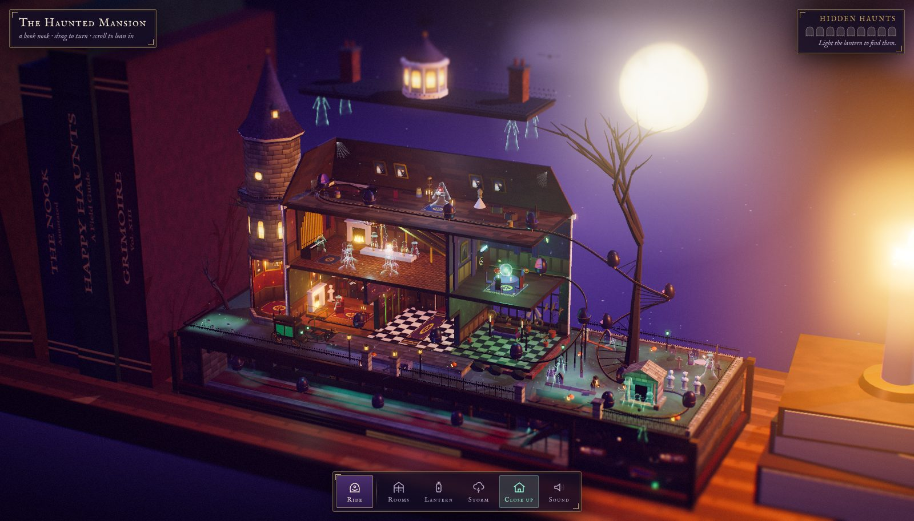
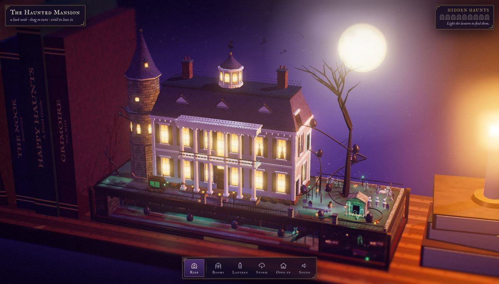
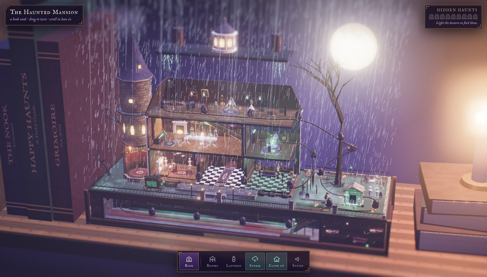
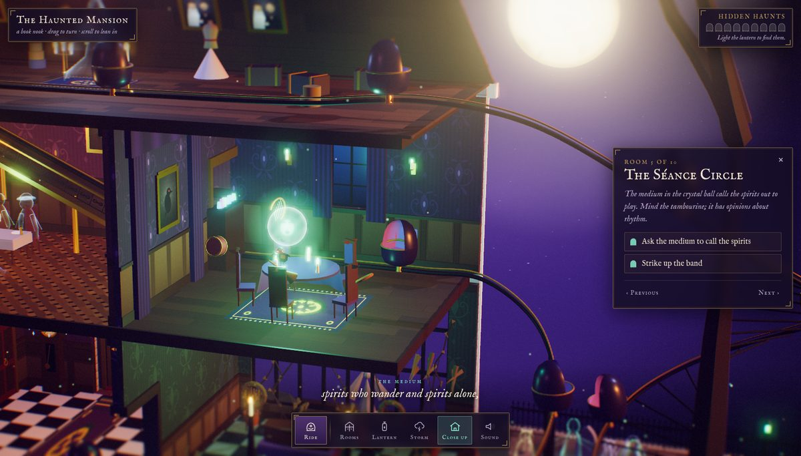
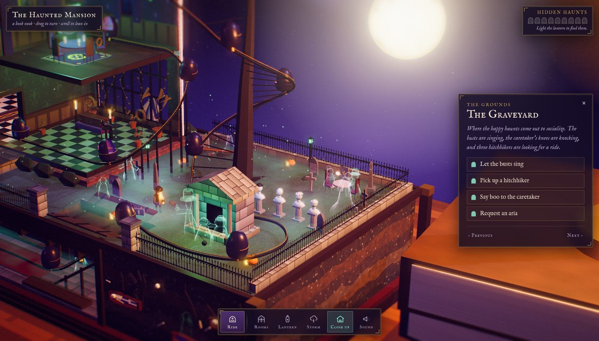
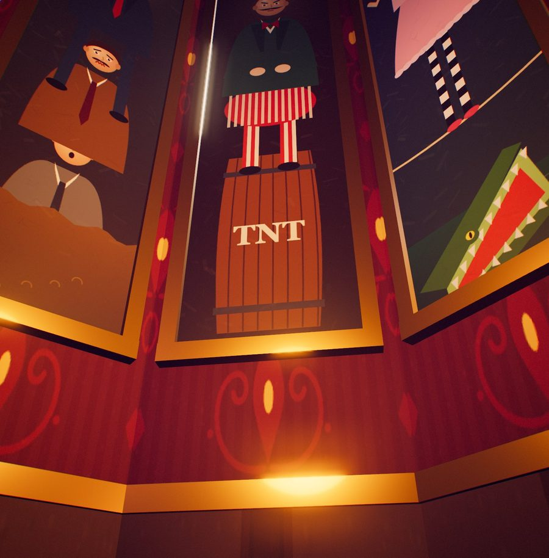
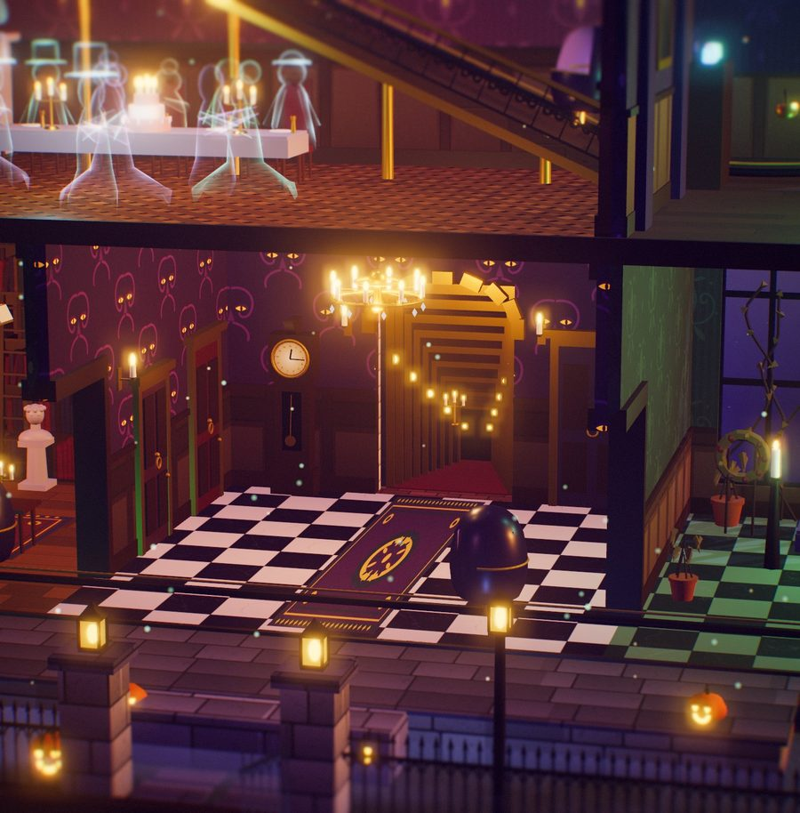
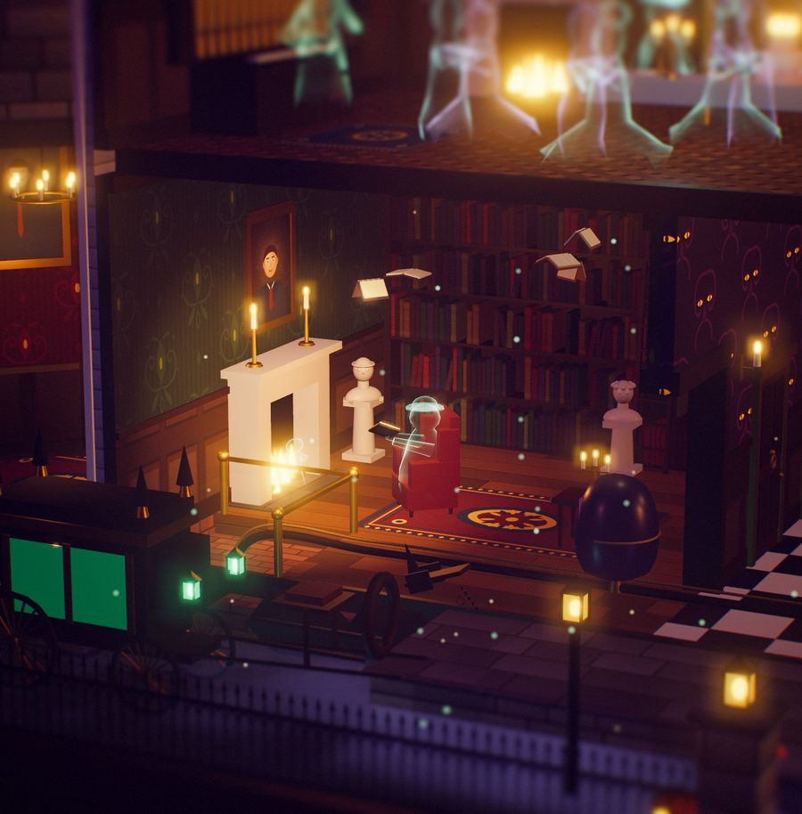
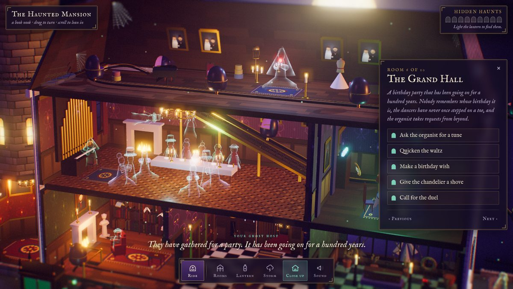

# The Haunted Mansion — Book Nook

An interactive 3D book-nook diorama of the Haunted Mansion ride, built entirely in the browser with three.js. The mansion sits on a bookshelf between giant leather books and a lit candle. The walls facing you melt away so you can see into every room, the residents react when you poke them, and a Doom Buggy will take you through the whole house in first person.

*An unofficial fan tribute. All artwork, music, sound and narration here are original and generated in code.*



## What's inside

| | |
|---|---|
|  |  |
|  |  |

**Nine rooms and the grounds**

- **Stretching Room** (the tower): its portraits stretch to reveal the TNT keg, the crocodile under the tightrope and the gentlemen sinking in quicksand.
- **Library:** marble busts that turn to watch you, books that fly like birds, a ghost reading by the fire, and a portrait that ages when you look closer.
- **Endless Hallway:** a forced-perspective corridor with a floating candelabra, plus doors that knock and bulge and a clock that strikes thirteen.
- **Conservatory:** wilted plants, a raven, and a coffin whose occupant would like to get out.
- **Séance Circle:** the medium's face glows in a crystal ball while instruments orbit the table and the chairs rattle.
- **Grand Hall:** waltzing couples, a hooded organist with banshees rising from the pipes, a birthday table, a ghost swinging from the chandelier and duelling portraits.
- **Attic:** a bride with a beating heart, wedding portraits that keep losing their grooms, a shadow at the piano and ghosts popping out of trunks.
- **Portrait Hall** (below stairs): portraits that turn monstrous when the lightning strikes, and the Doom Buggy load area.
- **Grounds:** a hearse pulled by an invisible horse, a pet cemetery, five singing busts, the caretaker and his trembling dog, a tea party, a royal teeter-totter, and three hitchhikers waiting at their crypt. The soil under the graveyard is cut away to show who is buried there.

| | | |
|---|---|---|
|  |  |  |

## Things to try

- **Ride:** board a Doom Buggy. The ride starts in the Stretching Room, travels through every room with a ghost host narrating, drops backwards out of the attic into the graveyard, and ends at a mirror. Check who is sitting next to you.
- **Lantern:** the lights go out and your cursor becomes a lantern. Nine hidden haunts only show up in its glow. Find all nine for a surprise.
- **Storm:** rain and lightning roll in.
- **Close up / Open up:** put the facade back to see the mansion from outside, or melt it away again.
- **Click any room** to fly in. The side panel lists what you can do there, or click the residents directly.
- **Sound:** everything you hear is synthesized live: wind, owls, thunder, an original waltz in D minor whose instrument changes from room to room (organ, music box, theremin, and the busts as a five-voice choir), and dozens of sound effects.



### Controls

| Input | Action |
|---|---|
| Drag | Turn the nook |
| Scroll / pinch | Lean in or out |
| Click | Visit a room, or poke a resident |
| `R` | Ride the Doom Buggy |
| `L` | Lantern |
| `S` | Storm |
| `O` | Open or close the house |
| `M` | Sound on or off |
| `←` `→` | Previous or next room |
| `Esc` | Back out of a room, or leave the ride |

## Running it locally

It's a static site made of ES modules, so it needs to be served over HTTP rather than opened as a file:

```bash
python3 -m http.server 8000
```

Then open <http://localhost:8000>. You need a browser with WebGL and an internet connection, because three.js (r170) and the two fonts load from CDNs.

On `localhost` you can skip the title card while developing: `?autoenter` enters straight away, and you can add `&focus=ballroom` (any room id) or `&ride`.

## How it's built

There are no image, model or audio files. Every mesh is built from primitives, every texture (wallpapers, wood, slate, soil strata, all the portraits, the faces in the crystal ball and on the busts) is painted onto canvases at load time, and all sound is generated with the Web Audio API.

| File | What it does |
|---|---|
| `js/main.js` | Boots the renderer, camera, lights and frame loop, and assembles the world |
| `js/core.js` | Shared state, helpers, geometry merging, the dissolving-wall shader and the ghost shader |
| `js/tex.js`, `js/paint.js` | Procedural textures and the painted portraits and faces |
| `js/materials.js` | Builds every texture and shared material once |
| `js/house.js` | Plinth and basement, the mansion shell, mansard attic, levitating roof, stretching tower, bookshelf |
| `js/rooms.js` | Every interior room, its residents and interactions |
| `js/outside.js` | Front lawn, hearse, graveyard, crypt, sky, bats, fog |
| `js/props.js` | Reusable props: candles, chandeliers, bookshelves, busts, coffins, ravens, trees… |
| `js/ride.js` | The track, the Doom Buggies and the first-person ride with the mirror finale |
| `js/fx.js` | Lightning, rain, the lantern and the hidden-haunt hunt |
| `js/audio.js` | The synthesizer, the score and sound effects |
| `js/post.js` | Bloom, tilt-shift miniature blur and colour grade |
| `js/ui.js` | Picking, hover labels, room panels, the dock, captions and the ride overlay |

A few techniques keep it running at 60 fps:

- Static geometry is merged into one mesh per material. Animated props are tagged so they survive merging with their own transforms intact.
- The shadow map is redrawn only when the architecture moves (walls dissolving, the roof lifting, the tower stretching), and small moving props don't cast shadows.
- All candle flames are drawn as three instanced meshes.
- Lights are never added, removed or hidden after start-up, because that would force every shader to recompile.
- The facade melts with a 3D-noise dissolve shader whose edges glow like ectoplasm.
- In the mirror, the hitchhiker is switched on only for the reflection's render pass, so you can see him in the glass but not beside you.

## Disclaimer

This is an unofficial, non-commercial fan tribute. It is not affiliated with, sponsored by or endorsed by The Walt Disney Company. "Haunted Mansion" and "Doom Buggy" are names associated with Disney's attraction and are used here only to describe what this diorama pays tribute to. No Disney artwork, audio, lyrics or logos are included; every image, sound and line of narration in this repository is original.
