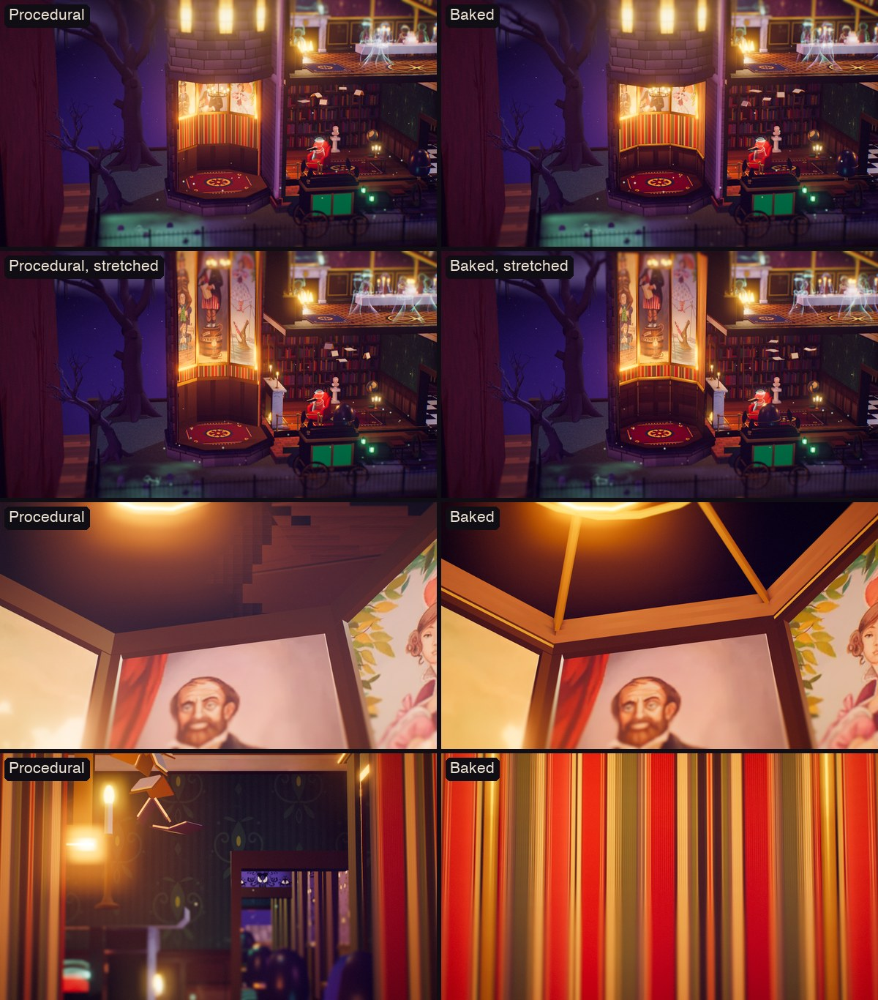
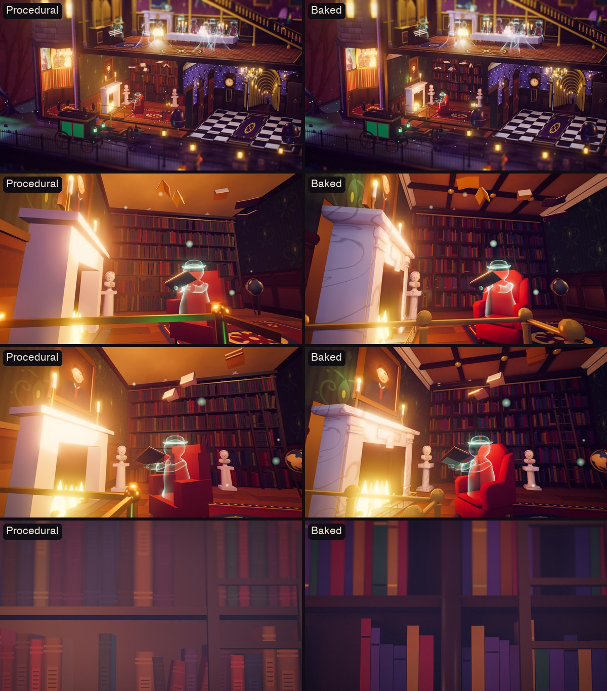
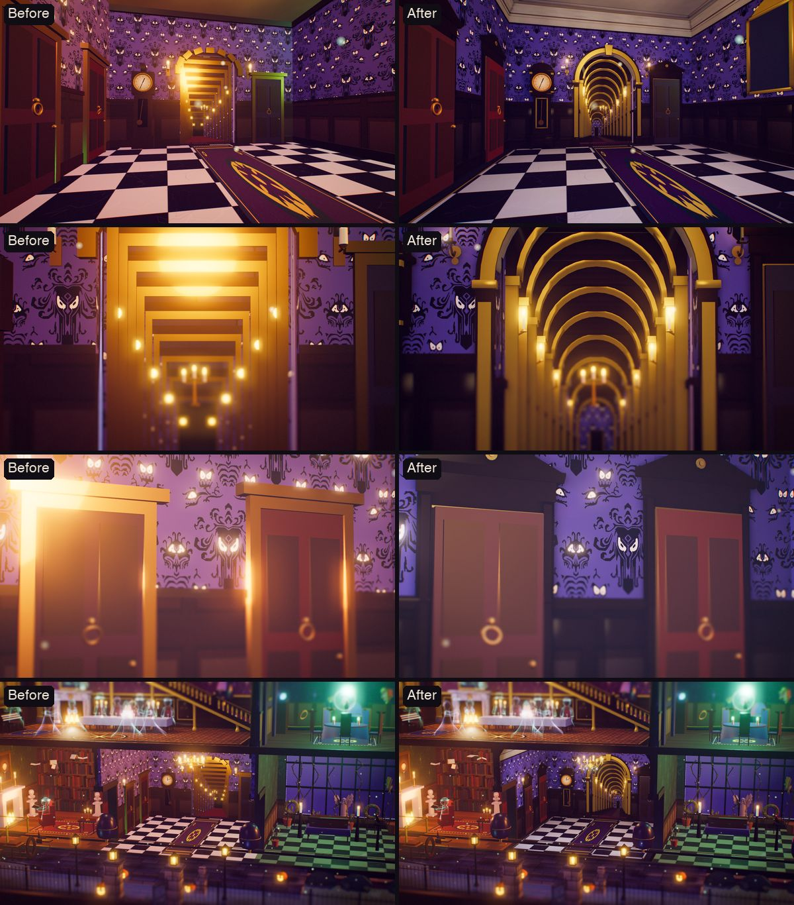
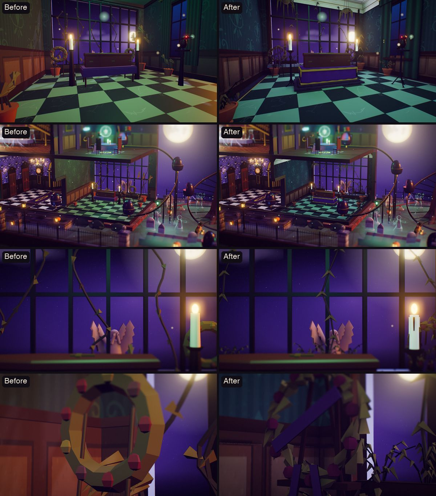
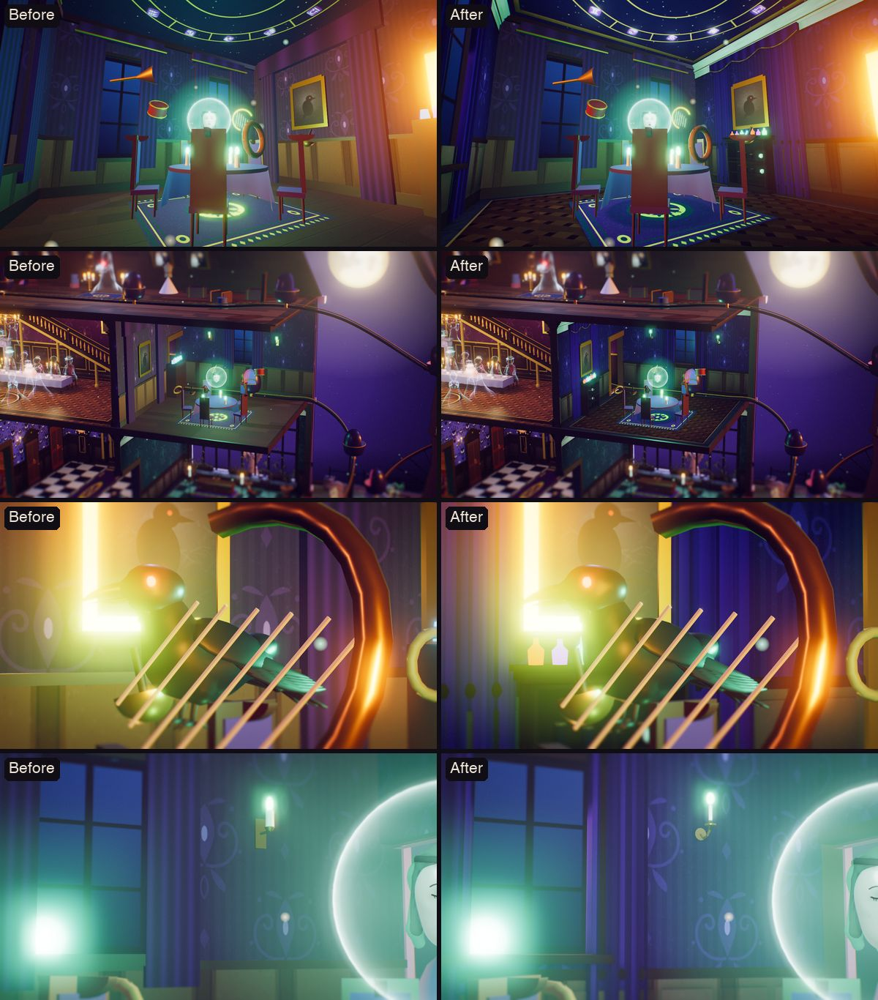
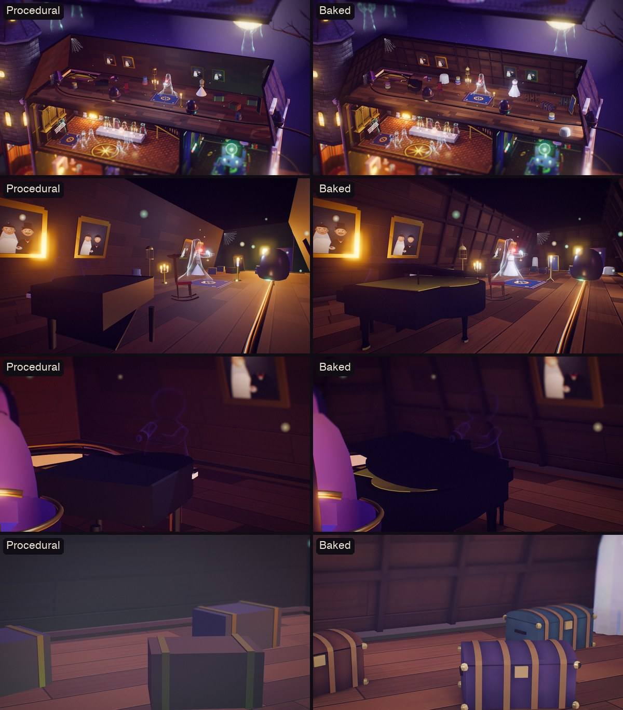
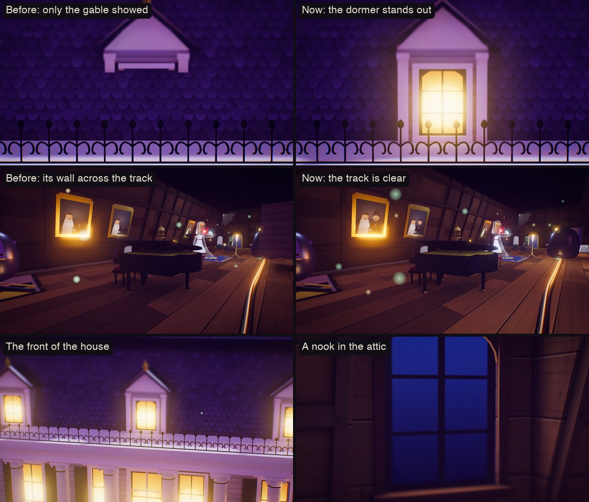
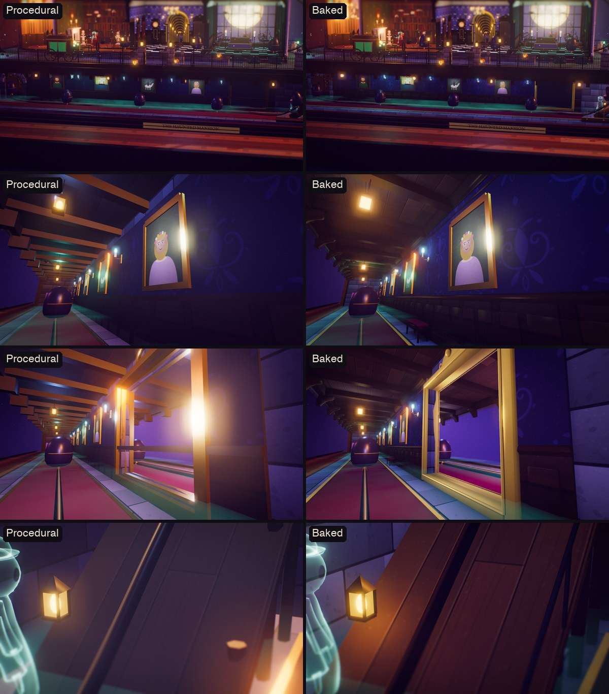
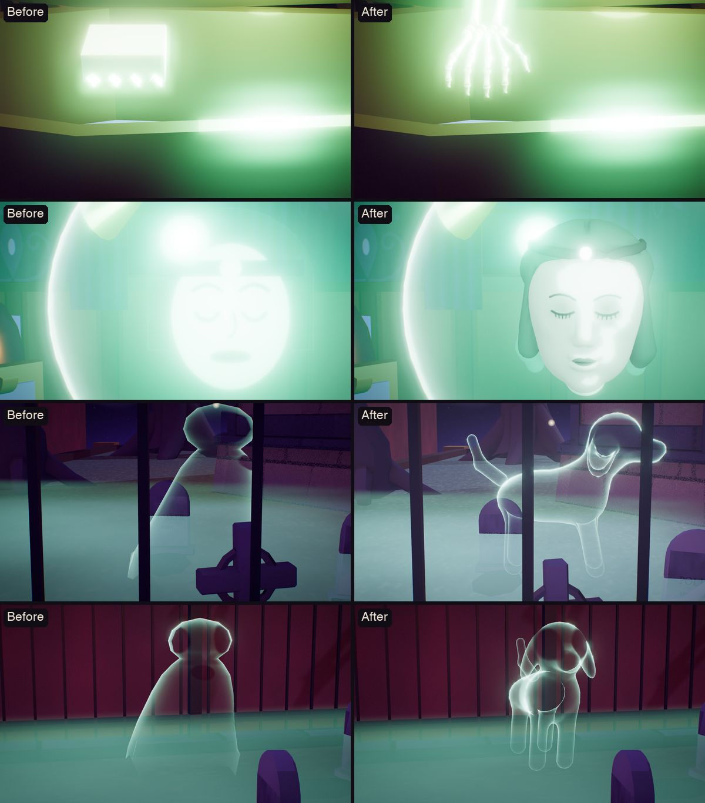

# The Haunted Mansion — Book Nook

An interactive 3D book-nook diorama of the Haunted Mansion ride, built entirely in the browser with three.js. The mansion sits on a bookshelf between giant leather books and a lit candle. The walls facing you melt away so you can see into every room, the residents react when you poke them, and a Doom Buggy will take you through the whole house in first person.

**▶ Visit the nook: <https://nacdwk.github.io/haunted-mansion-nook/>**

*An unofficial fan tribute. The music, sound and narration are original and generated in code. The artwork is too, apart from the Stretching Room's portraits and wallpaper and the Endless Hall's wallpaper (see [Credits](#credits)).*


## What's inside

| | |
|---|---|
|  |  |
|  |  |

**Nine rooms and the grounds**

- **Stretching Room** (the tower): its portraits stretch to reveal the dynamite keg, the crocodile under the tightrope, the gentlemen sinking in quicksand and the widow perched on George's headstone.
- **Library:** marble busts that turn to watch you, books that fly like birds, a ghost reading by the fire, and a portrait that ages when you look closer.
- **Endless Hallway:** a forced-perspective corridor with a floating candelabra, plus doors that knock and bulge and a clock that strikes thirteen.
- **Conservatory:** wilted plants, a raven, and a coffin whose occupant would like to get out.
- **Séance Circle:** the medium's face glows in a crystal ball while instruments orbit the table and the chairs rattle.
- **Grand Hall:** waltzing couples, a hooded organist with banshees rising from the pipes, a birthday table, a ghost swinging from the chandelier and duelling portraits.
- **Attic:** a bride with a beating heart, wedding portraits that keep losing their grooms, a shadow at the piano and ghosts popping out of trunks.
- **Portrait Hall** (below stairs): portraits that turn monstrous when the lightning strikes, and the Doom Buggy load area.
- **Grounds:** a hearse pulled by an invisible horse, a pet cemetery, five singing busts, the caretaker and his trembling dog, a tea party, a royal teeter-totter, and three hitchhikers waiting at their crypt. The soil under the graveyard is cut away to show who is buried there.

| | | |
|---|---|---|
|  |  |  |

## Things to try

- **Ride:** board a Doom Buggy. The ride starts in the Stretching Room, travels through every room with a ghost host narrating, drops backwards out of the attic into the graveyard, and ends at a mirror. Check who is sitting next to you.
- **Lantern:** the lights go out and your cursor becomes a lantern. Nine hidden haunts only show up in its glow. Find all nine for a surprise.
- **Storm:** rain and lightning roll in.
- **Close up / Open up:** put the facade back to see the mansion from outside, or melt it away again.
- **Click any room** to fly in. The side panel lists what you can do there, or click the residents directly.
- **Sound:** everything you hear is synthesized live: wind, owls, thunder, an original waltz in D minor whose instrument changes from room to room (organ, music box, theremin, and the busts as a five-voice choir), and dozens of sound effects.


### Controls

| Input | Action |
|---|---|
| Drag | Turn the nook |
| Scroll / pinch | Lean in or out |
| Click | Visit a room, or poke a resident |
| `R` | Ride the Doom Buggy |
| `L` | Lantern |
| `S` | Storm |
| `O` | Open or close the house |
| `M` | Sound on or off |
| `←` `→` | Previous or next room |
| `Esc` | Back out of a room, or leave the ride |

## Running it locally

It's a static site made of ES modules, so it needs to be served over HTTP rather than opened as a file:

```bash
python3 -m http.server 8000
```

Then open <http://localhost:8000>. You need a browser with WebGL and an internet connection, because three.js (r170) and the two fonts load from CDNs.

On `localhost` you can skip the title card while developing: `?autoenter` enters straight away, and you can add `&focus=ballroom` (any room id) or `&ride`.

## How it's built

Apart from the baked sets (the Grand Hall, the outside of the mansion and the grounds), the sculpted figures, and the portraits and wallpaper listed under [Credits](#credits), there are no image, model or audio files. Every mesh is built from primitives, every texture (wallpapers, wood, slate, soil strata, all the portraits, the faces in the crystal ball and on the busts) is painted onto canvases at load time, and all sound is generated with the Web Audio API.

| File | What it does |
|---|---|
| `js/main.js` | Boots the renderer, camera, lights and frame loop, and assembles the world |
| `js/core.js` | Shared state, helpers, geometry merging, the dissolving-wall shader and the ghost shader |
| `js/tex.js`, `js/paint.js` | Procedural textures and the painted portraits and faces |
| `js/materials.js` | Builds every texture and shared material once |
| `js/house.js` | Plinth and basement, the mansion shell, mansard attic, levitating roof, stretching tower, bookshelf |
| `js/rooms.js` | Every interior room, its residents and interactions |
| `js/outside.js` | Front lawn, hearse, graveyard, crypt, sky, bats, fog |
| `js/props.js` | Reusable props: candles, chandeliers, bookshelves, busts, coffins, ravens, trees… |
| `js/ride.js` | The track, the Doom Buggies and the first-person ride with the mirror finale |
| `js/fx.js` | Lightning, rain, the lantern and the hidden-haunt hunt |
| `js/audio.js` | The synthesizer, the score and sound effects |
| `js/post.js` | Bloom, tilt-shift miniature blur and colour grade |
| `js/ui.js` | Picking, hover labels, room panels, the dock, captions and the ride overlay |
| `js/baked.js` | Loads the Blender-built Stretching Room, Library, Grand Hall, Endless Hall, Conservatory, Séance Circle, Attic, basement, exterior and grounds and draws them with their baked light, and loads the sculpted figures |
| `js/art.js` | Swaps in the official Stretching Room portraits and wallpaper and the Endless Hall wallpaper from `assets/art/`, when those files are present |
| `tools/prepare_art.py` | Crops the portraits, cuts a seamless tile of the Endless Hall wallpaper and redraws the Stretching Room's stripes from the source images into `assets/art/` |
| `blender/` | The Blender scripts that model and light-bake the Grand Hall (`grand_hall.py`), the Stretching Room (`stretching_room.py`), the Library (`library.py`), the Endless Hall (`endless_hall.py`), the Conservatory (`conservatory.py`), the Séance Circle (`seance.py`), the Attic (`attic.py`), the basement (`basement.py`), the exterior and tower (`exterior.py`) and the grounds (`grounds.py`) and the solid figures (`figures.py`), their shared helpers (`kit.py`, and `trees.py` for the dead trees), the house's lights shared between the last two (`exterior_lights.json`), and `bake.sh` to rebuild `assets/` |

A few techniques keep it running at 60 fps:

- Static geometry is merged into one mesh per material. Animated props are tagged so they survive merging with their own transforms intact.
- The shadow map is redrawn only when the architecture moves (walls dissolving, the roof lifting, the tower stretching), and small moving props don't cast shadows.
- All candle flames are drawn as three instanced meshes.
- Lights are never added, removed or hidden after start-up, because that would force every shader to recompile.
- The facade melts with a 3D-noise dissolve shader whose edges glow like ectoplasm.
- In the mirror, the hitchhiker is switched on only for the reflection's render pass, so you can see him in the glass but not beside you.

## Baked sets (experiment)

Every room of the nook is now modelled in Blender and lit with Cycles instead of being built from primitives at load time: the Stretching Room, the Library, the Endless Hall, the Conservatory, the Séance Circle, the Grand Hall, the Attic and the basement's Portrait Hall. So are the outside of the mansion with its stretching tower and the grounds around it. The solid figures are sculpted there too: the caretaker and his dog, the marble busts, the raven, the coffin's bony hands and Madame Leota (see below), and so is the ghost dog's shape. Everything else, including the other ghosts and the other things that move, is still procedural.

- A Python script in `blender/` builds each set (`grand_hall.py`, `exterior.py` and `grounds.py`, with shared helpers in `kit.py` and `trees.py`) and removes faces nobody can see. It then bakes two lightmaps, warm (flames, lamps and lit windows) and cool (moonlight, sky and fill light), and exports Draco-compressed geometry. Thin ironwork is exported without a lightmap and lit live by the site, though it still shades the baked surfaces around it.
- `js/baked.js` draws the sets with one cheap shader. It reads the lightmaps, maps the site's painted textures onto the surfaces and adds the lantern.
- Because the two lightmaps are separate, the sets still dim for the lantern, flicker with the flames and flash with lightning. Their walls melt away with the facades, and the tower still stretches.
- Rebuild a set with `blender/bake.sh grandhall`, `blender/bake.sh stretch`, `blender/bake.sh library`, `blender/bake.sh endless`, `blender/bake.sh conserv`, `blender/bake.sh seance`, `blender/bake.sh attic`, `blender/bake.sh basement`, `blender/bake.sh exterior` or `blender/bake.sh grounds` (after the exterior, whose house and lights it uses), and the figures with `blender/bake.sh figures`. Each takes under a minute on an M4 GPU and writes the web-ready files to `assets/`.
- To compare, add `?baked=0` to the URL for the all-procedural nook, or `?stretch=0`, `?library=0`, `?endless=0`, `?conserv=0`, `?seance=0`, `?attic=0`, `?basement=0`, `?exterior=0` or `?grounds=0` for the procedural version of just that set, or `?figures=0` for the old figures and ghosts. If a baked set fails to load, the site builds the procedural version in its place.

### The Grand Hall


The new set has a coffered ceiling, fluted gilt pilasters, raised panels, dentil cornices, turned balusters on the gallery, a veined marble fireplace with a mirror overmantel, a pipe organ with a three-manual console, an inlaid parquet floor with a star medallion, curtained windows and wall sconces. The residents, the chandelier, the cake and the portraits are still the procedural ones. Its cool lightmap also holds the ghosts' glow and ambient occlusion, polished floors and marble show glints of the flames, and gilt gets a fake reflection.

Measured in headless Chrome on an M4 MacBook, against the same views in the procedural version:

| | Procedural | Baked |
|---|---|---|
| Download for the whole page (cache off) | 683 KB | 1,293 KB (+610 KB: 496 KB of model and lightmaps, ~100 KB of glTF/Draco loaders) |
| GPU time per frame at Retina size, whole hall in view | 13.5–15.9 ms | 13.4–14.2 ms |
| GPU time per frame at Retina size, close-up of the hall | 13.0–13.9 ms | 7.2–8.0 ms |
| GPU time per frame at Retina size, riding through the hall | 51.2 ms | 43.4 ms |
| Draw calls (with shadow pass) / triangles | 659 / 248k | 668 / 274k |

The baked hall has more geometry but costs less to draw where it fills the screen, because its surfaces don't add up a dozen point lights for every pixel. The price is download size.

### The Stretching Room



The octagonal chamber in the tower, with no windows and no doors, where the ride begins, is a set too (`blender/stretching_room.py`). Its walls still stretch.
- **The walls.** Each wall has the striped paper (the official stripes, or the house's own), panelled wainscot under a gilt chair rail, and a gilt bead down each corner. Each wall's dressing sits in its wall's stretching group, so it stretches and melts with that wall.
- **The ceiling.** The ceiling has a cornice, and gilt ribs run from its corners to two rings round the trapdoor. It rises with the upper tower as the room stretches, keeping its shape.
- **The wall against the house.** The site left it undressed, so you could see into the Library through it. It's now dressed like the others.
- **The light.** The room's lamp and the chandelier's candles are baked at rest.
- **Still procedural.** The stretching portraits and their frames, the chandelier and the trapdoor stay the site's, and so does the tower's stonework (the exterior's).
- **A shader fix.** On walls at exactly 45 degrees, the baked shader's texture projection used to flip between faces from pixel to pixel, which showed as grain. It now always takes the same face.

| | Procedural room | Baked room |
|---|---|---|
| Download for the whole page (cache off) | 4,979 KB | 5,117 KB (+138 KB) |
| GPU time per frame at Retina size, the room view | 7.5 ms | 7.2–7.9 ms |
| GPU time per frame at Retina size, inside, where the ride begins | 12.2 ms | 5.7 ms |
| Draw calls (with shadow pass) / triangles, the room view | 512 / 457k | 509 / 459k |

### The Library



The ground floor's left-hand room, the first the Doom Buggies reach after the tunnel, is a set too (`blender/library.py`).
- **The shelves.** They run wall to wall along the back in six bays, filled with books in their leathers, some with gilt bands, some lying down. The busts still stand on the crown, and the sliding ladder still runs on its rail.
- **The chimneypiece.** It's marble, with pilasters, a keystone and a mantel, over a sooty firebox with andirons and logs and a brass fender. The site's fire burns in it.
- **The room.** The walls have wainscot, the room's damask, a picture rail and a cornice, and the ceiling is coffered, with gilt bosses where its beams cross. The wingback, a turned reading table with books and a candelabra, the marble pedestals and the red rug are part of the set.
- **The railing.** The brass railing round the hole the ride comes up through used to cross the buggies' way out. It now leaves that side open.
- **The light.** The fire and the candles are baked, the fire flickering harder than a candle does, and moonlight comes through the front windows.
- **Still procedural.** Everything that moves stays the site's: the fire's flames, the busts, the ladder, the flying books, the reader, the globe and the ageing portrait. So do the front wall and the partition's door casing.
- **The same random numbers.** The shelves' books and the fire drew from the house's shared random sequence. The shelves are still built, into a group that's thrown away, and their books still say where a pulled book flies from. The fireplace draws only its fire (`onlyFire` in `js/props.js`).

| | Procedural room | Baked room |
|---|---|---|
| Download for the whole page (cache off) | 4,668 KB | 4,973 KB (+306 KB) |
| GPU time per frame at Retina size, the room view | 12.8 ms | 10.0–11.7 ms |
| GPU time per frame at Retina size, riding through it | 65.1 ms | 47–48 ms |
| Draw calls (with shadow pass) / triangles, the room view | 573 / 467k | 569 / 474k |

### The Endless Hall



The middle room of the ground floor, where the candelabra floats, is a set of its own (`blender/endless_hall.py`).
- **The walls.** The back wall and both partitions have a baseboard, raised-panel wainscot under a chair rail, the wallpaper (the official one when it's there, with its eyes still glowing and breathing), a picture rail, a plaster frieze and a deep cornice with a gilt bead.
- **The arch.** The opening to the corridor is round-headed now, with a gilded archivolt, a keystone and pilasters with gilt capitals.
- **The furnishings.** The knocking doors have moulded architraves on plinth blocks, a frieze, a cornice and a pediment with a gilt rosette. The clock with thirteen hours has a proper case: bracket feet, a panelled plinth, quarter columns on the trunk, a gilt frame round the pendulum's window, columns beside the dial and a domed hood with finials.
- **Light and floor.** A brass chandelier hangs from a plaster rosette on a chain, with eight scrolled arms, candles and crystal drops. There are brass sconces, a gilt mirror, a checker floor inside a dark marble border with a brass inlay, and the purple rug.
- **The corridor.** The corridor behind the arch is a run of nine gilded arches with panelled walls, wallpaper, a ceiling, sconces and a runner down to a door that never opens. It is modelled as a straight hall 16 units long and then squeezed into the 2.9 the house has behind its back wall, shrinking towards the far end as the old corridor did. The site shrinks its textures with it, so the wallpaper and the runner read as if the corridor ran on straight.
- **Still procedural.** The front wall stays procedural, as in the Grand Hall: it melts away when the house opens, and the ride faces the other way. So do the doors themselves, which still bulge and knock, the clock's dial, hands and pendulum, and the floating candelabra.

Measured the same way, one run each, with every other set baked:

| | Procedural hall | Baked hall |
|---|---|---|
| Download for the whole page (cache off) | 3,316 KB | 3,711 KB (+395 KB) |
| GPU time per frame at Retina size, the hall's room view | 11.5 ms | 9.4 ms |
| GPU time per frame at Retina size, riding past the hall | 53.9 ms | 38.7 ms |
| Draw calls (with shadow pass) / triangles, the hall's room view | 579 / 464k | 588 / 480k |

### The Conservatory



The ground floor's right-hand room, where the coffin lies in state, is the next set (`blender/conservatory.py`).
- **The glass wall.** The big glass wall has a moulded casing and a deep stone planting shelf below it, with planters of dead plants and vines climbing the glass. Its iron grid stays the site's, but it is in the bake, so the moonlight pouring through it is barred across the floor.
- **The bier.** The coffin rests on a stepped catafalque under a velvet pall that falls in folds, with gold fringe and tassels.
- **The furnishings.** Tall baluster stands hold church candles either side of the bier. There are funeral wreaths of dead leaves and withered roses with mourning sashes on easels, and terracotta urns of dead plants, one a dead palm. The raven has a scrolled iron stand, and baskets of dead ferns hang from the ceiling.
- **The walls.** The side window has green velvet drapes and a pelmet. The walls have wainscot, the room's damask, a picture rail and a cornice, over a green checker floor in a marble border.
- **The light.** The room's green glow, the candles and the moonlight are baked.
- **The coffin's own light.** The coffin stays the site's: its lid still lifts, the hands still peek out, and the green light inside still flares. The baked shader now takes one live point light, so that flare lights the baked bier and floor round it too.
- **Same random numbers.** The plants, wreaths and vines it replaces rolled the house's dice, so the site still builds them, into a group it throws away, and everything built after them comes out the same.

| | Procedural conservatory | Baked conservatory |
|---|---|---|
| Download for the whole page (cache off) | 3,716 KB | 4,147 KB (+431 KB) |
| GPU time per frame at Retina size, the room view | 11.4 ms | 8.4 ms |
| GPU time per frame at Retina size, riding through it | 50.9 ms | 39.4 ms |
| Draw calls (with shadow pass) / triangles, the room view | 493 / 449k | 499 / 452k |

### The Séance Circle



Madame Leota's room upstairs, the ride's next stop after the Conservatory, is a set too (`blender/seance.py`). Nearly everything in it moves, so the set is the room round them.
- **The partition.** Velvet drapes in folds frame the portrait, under a swagged valance with a gilt fringe. The cabinet of curiosities stands beneath it now, with skulls and jars on its shelves and bottles glowing on top. It used to stand where the Doom Buggies leave for the Grand Hall, and they drove through it.
- **The windows.** Both have casings, drapes and pelmets on gilt rods, and two sconces hold green-flamed candles on the back wall.
- **The walls, floor and ceiling.** The walls have wainscot, the room's damask and a cornice. The floor is parquet in a dark border under the rug, and the zodiac ceiling, in a gilt frame, still glows a little.
- **The light.** The crystal ball's green light moves with it, so it isn't baked. The baked surfaces get it live, as the procedural room did, while the candles and the moonlight are baked.
- **Still procedural.** The table, the ball and Leota, the chairs, the instruments, the raven and the portrait stay the site's.

| | Procedural room | Baked room |
|---|---|---|
| Download for the whole page (cache off) | 4,151 KB | 4,286 KB (+134 KB) |
| GPU time per frame at Retina size, the room view | 9.0 ms | 7.4 ms |
| GPU time per frame at Retina size, riding through it | 60.5 ms | 49.0 ms |
| Draw calls (with shadow pass) / triangles, the room view | 520 / 453k | 524 / 457k |

### The Attic



The long room under the mansard, where the bride waits with a candle, is a set too (`blender/attic.py`). It's the ride's next stop after the Séance Circle and the Grand Hall.
- **The roof.** Each slope is lined with planks on rafters and purlins, with beams along the hips. The Doom Buggies' way out through the right slope is framed with jambs and a header. Each slope's lining melts with that slope.
- **The furniture.** The grand piano has a proper keyboard and a lid on its short stick. The site's own piano had its tail through the pianist. The steamer trunks have domed lids, wooden slats and brass corners. There are stacked hat boxes, a dress form in a gown that falls in folds, a birdcage, candle stands, a cheval mirror, and furniture under dust sheets.
- **The light.** The bride's light never moves, so it is baked with the candles. The night comes in through the ride's opening.
- **The dormers.** They used to sit almost entirely behind the shingles, with their windows hidden, and reached two metres into the attic, so the Doom Buggies drove through their walls. Now they stand out from the roof (in the exterior's set and in the procedural house), and their arched windows glow between pilasters. Behind each one, the slope opens into a plank-lined nook in the attic, with the window at its back and moonlight coming in.



- **Still procedural.** Everything that moves stays the site's: the bride with the candelabra, the ghosts in the trunks, the pianist, and the rocking chair. So do the wedding portraits and the cobwebs.
- **Brightness.** The procedural attic took most of its light from the house's ambient light, so the baked one leans on its ambient layer (`?akw=` and `?akc=` tune it).

| | Procedural room | Baked room |
|---|---|---|
| Download for the whole page (cache off) | 4,294 KB | 4,511 KB (+217 KB) |
| GPU time per frame at Retina size, the room view | 7.8 ms | 5.2–5.6 ms |
| GPU time per frame at Retina size, riding through it | 55.5 ms | 45 ms |
| Draw calls (with shadow pass) / triangles, the room view | 702 / 531k | 698 / 536k |

### The basement



The Portrait Hall under the front lawn, where the Doom Buggies are boarded and where the ride ends at the mirror, is a set too (`blender/basement.py`).
- **The back wall.** A panelled wainscot and chair rail sit under the hall's dark damask, with a picture rail and a cornice above. The tunnel the ride leaves by has a proper arch of voussoirs with a keystone, and the mirror has an ornate gilt frame with a crest.
- **The hall.** The ceiling's beams rest on scrolled corbels along the front. Over the ramp the ride comes down, the ceiling is open, with trimmers round the opening; the old ceiling had the Doom Buggies drive through it.
- **The furnishings.** Brass sconces hold blue candles, and iron lanterns over the track glow amber. Two velvet benches stand under the portraits. The boarding platform has brass stanchions with velvet ropes, the sign has a framed board, and the ramp stands on trestles with a rail.
- **The light.** The sconces, the lanterns, the attendant's lantern and the hall's two fill lights are baked. The night comes down through the cellar opening. The light the ride turns on at the mirror reaches the baked frame live, and live lights now reach metal surfaces too, so the coffin's glow also catches the Conservatory's gilt.
- **Still procedural.** The lightning portraits, the mirror itself, the sign's lettering, the attendant, the raven, the cobwebs and the gears in the tower's shaft stay the site's, and so do the earth round the hall and the nook's frame.

| | Procedural room | Baked room |
|---|---|---|
| Download for the whole page (cache off) | 4,515 KB | 4,664 KB (+149 KB) |
| GPU time per frame at Retina size, the room view | 10.9 ms | 9.0–9.5 ms |
| GPU time per frame at Retina size, riding through it | 55.5 ms | 44.1 ms |
| Draw calls (with shadow pass) / triangles, the room view | 581 / 438k | 583 / 442k |

### The exterior


The four facades now have clapboard siding over a brick base, corner pilasters and a cornice on scrolled brackets. Every window has a full casing and a sill on brackets, with a pediment upstairs and a keystone below, and louvred shutters wherever there's room. The portico's six columns are turned and tapered, with capitals, and the front door has a sunburst fanlight and panelled leaves. The mansard has pedimented dormers with gold finials, their arched windows set in casings between pilasters, and the roof that floats up when the house opens has corbelled chimneys and a domed cupola.

The moon throws real shadows from the columns, cornices, shutters and sills. The windows spill warm light onto their casings and the portico, and the gas lamps light the porch.


The stretching tower's stonework is part of the set: a foundation with a water table, the Stretching Room's walls with plinth and string courses and corner pilasters, banded masonry above with round-headed window surrounds, keystones and sills, ringed round windows, a balcony on corbels with a wrought-iron railing, and a flared shingle spire with ridge rolls, two dormers and a gilt finial. Each of the room's walls melts with its own facet and stretches with the room, and the upper tower rises as it stretches.

The window panes, cresting and ghosts stay procedural. The baked walls don't receive the live shadow map, so the passing Doom Buggies no longer cast shadows on them.

### The grounds


The grounds are a set of their own: the graveyard's walls and railings, its tombstones, the crypt, the cellar doors, the busts' pedestals, lamp posts, the tea party's table and chairs and the teeter-totter's stone; the front yard's railings, gate, pillars, gas lamps, flagstones and bushes, and the pet cemetery; the weeping angel behind the house; and the hearse, with a gilded roof gallery, ostrich plumes and spoked wheels. The crypt's green glow, the busts' blue light and the caretaker's lantern are baked onto the stone round them.


All four dead trees are grown in Blender by `blender/trees.py`, which replays the site's own random numbers to get the same branches. It grows a detailed tree on them: a twisting, ridged trunk on buttress roots, surface roots that sink into the lawn, knots and broken-off stubs, forks that split like real wood, and a finer crown of hooked twigs. The great oak by the tower gets the Spanish moss the site hangs on it. Twigs that would reach into the Doom Buggies' path are left off, and the trees nearest the house shadow its walls in the exterior's bake.

Apart from the figures (below), everything that moves stays procedural: the ghosts, the teapot, the teeter-totter's plank, the horse's harness, the lanterns and the jack-o'-lanterns. So do the painted epitaphs and the crypt's plaque, which sit on the baked stones. The tombstones' sizes and tilts now come from a table shared with the bake.

Measured the same way, one run each, with the Grand Hall baked and the official art in both columns:

| | Procedural outside | Baked exterior and grounds |
|---|---|---|
| Download for the whole page (cache off) | 1,520 KB | 2,930 KB (+1,410 KB: 659 KB for the exterior and tower, 749 KB for the grounds) |
| GPU time per frame at Retina size, whole house in view | 10.2 ms | 7.1 ms |
| GPU time per frame at Retina size, close-up of the portico | 10.5 ms | 5.5 ms |
| Draw calls (with shadow pass) / triangles | 849 / 313k | 891 / 441k |

The baked outside costs less to draw than the procedural one even with 40% more triangles, because its surfaces don't add up the lights for every pixel. The price, again, is download size.

### The figures


The caretaker and his dog are sculpted in Blender by `blender/figures.py`. He has a slouch hat, a scarf, a long coat with folds, gloves holding the lantern, and boots. The dog is a thin, nervous hound with drooping ears. They move, so instead of lightmaps they carry ambient occlusion baked into their vertex colours and are lit live by the lantern and the moon. His legs and body and the dog's body and head are separate objects, so they still tremble and look around.


The marble busts are sculpted the same way, their heads in metaballs that fuse like clay. They share one head, with a brow, cheekbones, a long nose, parted lips, ears, and eyes with carved pupils. Each bust dresses to match its hat:
- the tenor: a frock coat and cravat under a top hat;
- the baritone: a bow tie and wing collar under a bowler;
- the alto: a gown, a shawl and a cameo brooch, with her hair in a bun;
- the basso and the soprano: togas, one with curls and one with a laurel wreath.

Each stands on a turned socle. The singing busts' painted eyes and mouths are projected onto a thin shell over the front of the head, lined up with the carved eyes and lips, so they still sing frame by frame. The library's busts keep their carved stare as they turn to watch you.

The raven has a glossy body with a shaggy throat, a wedge-shaped tail, layered wings that still flap when it's startled, a heavy beak, feet that grip its perch, and the same glowing red eyes.



- **The hands.** The ones that peek out of the conservatory's coffin are skeletal, with wrist bones, knuckles and finger bones that hook over its rim.
- **Madame Leota.** She's a sculpted head inside the crystal ball, with her hair parted and falling past her ears, a headband with a glowing jewel, and earrings. Her closed eyes, brows and lips are painted onto her face like the busts', and her lips part as she speaks. She's lit from within (her shading is baked in) and turns to face you.
- **The ghost dog.** The pet cemetery's ghost is now a floppy-eared puppy with a wagging tail, drawn with the same glowing shader as the other ghosts.

All the figures come to 74,000 triangles and 353 KB (`assets/figures.glb`).

The ghosts are still made in code, so they cost nothing to download, but from a new generator in `js/core.js`. Each has an egg-shaped head on a neck and sloping shoulders, and a robe with folds whose hem trails off into wisps. Sleeves on curved arms end in mitten hands, and the hats are sized to the head: top hats, bowlers, crowns, a bun, the bride's veil (open in front of her face) and the organist's hood. The 59 ghosts went from 33,000 to 179,000 triangles. Their geometry stays indexed, so each vertex is wobbled once rather than once for every triangle it touches.

The ghosts' difference shows most up close. From the default room views they look much as before, if a little brighter where they crowd together. In one headless Chrome run on an M4, at Retina size, frame times with all the new figures stayed within run-to-run noise of the old ones: 9.2 ms with the whole house in view against 10.8 ms, and 5.0 ms against 5.7 ms close up on the portico. `?figures=0` shows the old figures and ghosts.

## Credits

- The four Stretching Room portraits are Disney's paintings of the attraction's stretching portraits, taken from Disney Store product images (© Disney).
- The Endless Hall's wallpaper is Panicked Pixie's recreation of the attraction's wallpaper, from their Redbubble listing, after Disney's original design.
- The Stretching Room's striped wallpaper is redrawn from a photo of the attraction's own wallpaper; its stripe colours are sampled from that photo.

These are used without permission in this non-commercial fan tribute. If you hold the rights to either and want them taken down, please open an issue. Deleting `assets/art/` puts the house's own painted portraits, its original eye-damask wallpaper and its own striped wallpaper back in their place, and `?art=0` shows those versions now.

## Disclaimer

This is an unofficial, non-commercial fan tribute. It is not affiliated with, sponsored by or endorsed by The Walt Disney Company. "Haunted Mansion" and "Doom Buggy" are names associated with Disney's attraction and are used here only to describe what this diorama pays tribute to. Apart from the artwork listed under Credits, no Disney artwork, audio, lyrics or logos are included, and every other image, sound and line of narration in this repository is original.
